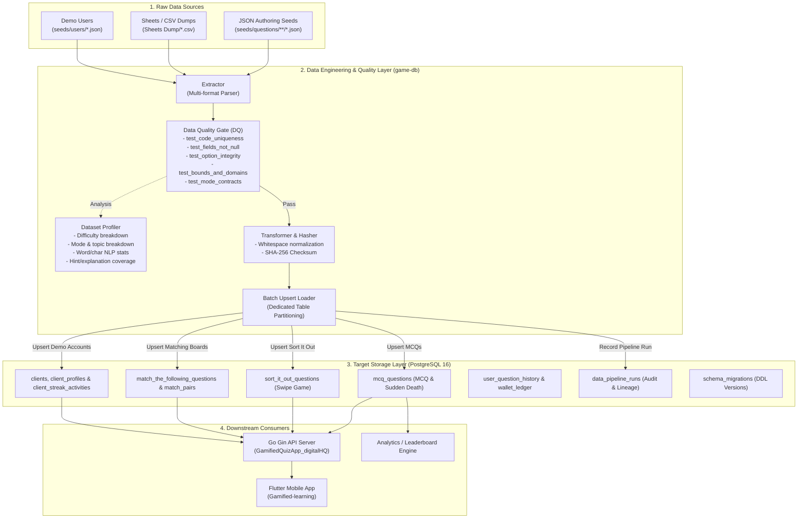

# SkillVerse Data Architecture

High-level data engineering architecture, pipeline stages, storage schemas, and downstream consumers.

---

## 1. End-to-End Pipeline Architecture

---

## 2. Pipeline Execution Stages

1. **Extract**: Parses JSON authoring seeds and optional Sheets dumps (`ExtractAllSources`).
2. **Data Quality Gate**: Runs 11 validation checks before any database touch (`quality.RunDataQualitySuite`).
3. **Transform & Fingerprint**: Computes deterministic SHA-256 dataset checksum (`pipeline.ComputeChecksum`).
4. **Idempotent Partitioned Load**: Batch upserts questions into dedicated tables (`mcq_questions`, `sort_it_out_questions`, `match_the_following_questions`, `match_pairs`).
5. **Audit Ledger**: Commits pipeline lineage metrics and duration to `data_pipeline_runs`.
