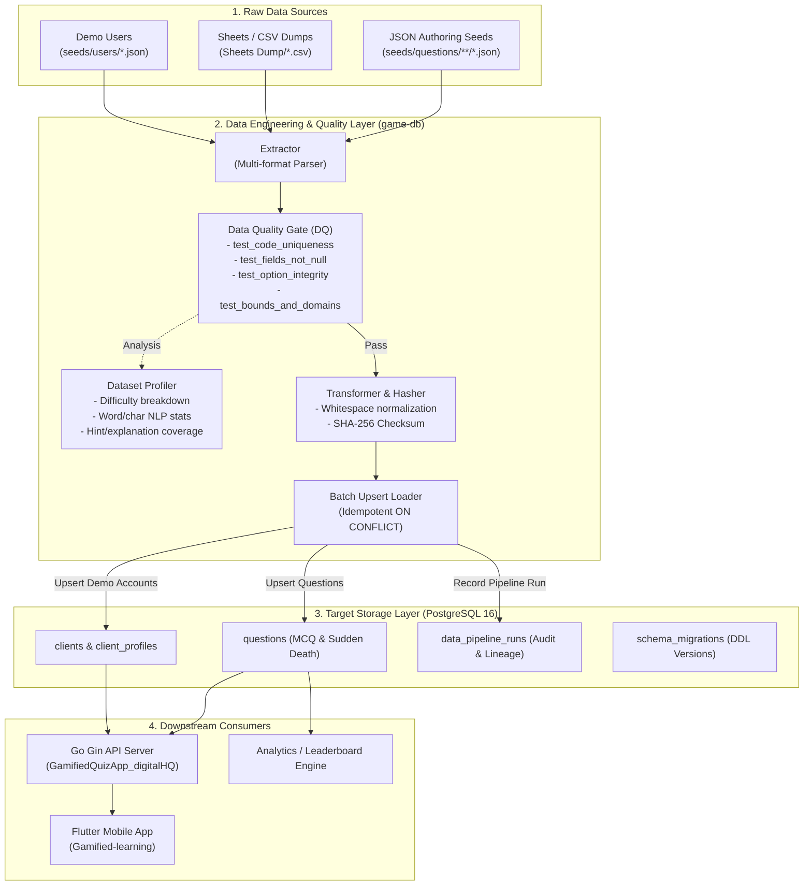

# SkillVerse Data Architecture

High-level data engineering architecture, pipeline stages, storage schemas, and downstream consumers.

---

## 1. End-to-End Pipeline Architecture

---

## 2. Pipeline Execution Stages

### Stage 1: Extraction & Ingestion
- Ingests structured JSON seeds (`seeds/questions/accounting/*.json`).
- Ingests raw CSV exports from content authoring tools (`Sheets Dump/*.csv`).
- Ingests user account fixtures (`seeds/users/*.json`).

### Stage 2: Data Quality (DQ) Testing Gate
Automated contract tests run against every record before insertion:
- **Uniqueness**: `question_code` must be globally distinct across topics.
- **Completeness**: `prompt`, `option_a`, `option_b`, `correct_option` cannot be empty.
- **Domain Constraints**: `question_type IN ('mcq', 'sudden_death')`, `difficulty BETWEEN 1 AND 5`, `points > 0`.
- **Integrity Constraints**: Sudden Death enforces the 2-option contract (`option_c` and `option_d` must be empty).
- **Option Deduplication**: No duplicate option text within the same question.

### Stage 3: Transformation & Cryptographic Checksum
- Sanitizes and trims whitespace from prompts, options, and explanations.
- Calculates deterministic SHA-256 hash for dataset versioning and drift detection.

### Stage 4: Idempotent Batch Loading
- Loads records in transactional batches with `ON CONFLICT (question_code) DO UPDATE`.
- Zero data loss, zero duplicate row generation on repeated executions.

### Stage 5: Lineage & Audit Logging
Every execution logs operational metadata into `data_pipeline_runs`:
- `run_id`: Unique run identifier.
- `records_processed` / `records_inserted`: Row-level throughput metrics.
- `duration_ms`: Execution latency.
- `checksum`: Cryptographic fingerprint of the dataset version.
- `status`: Execution state (`SUCCESS` or `FAILED`).
